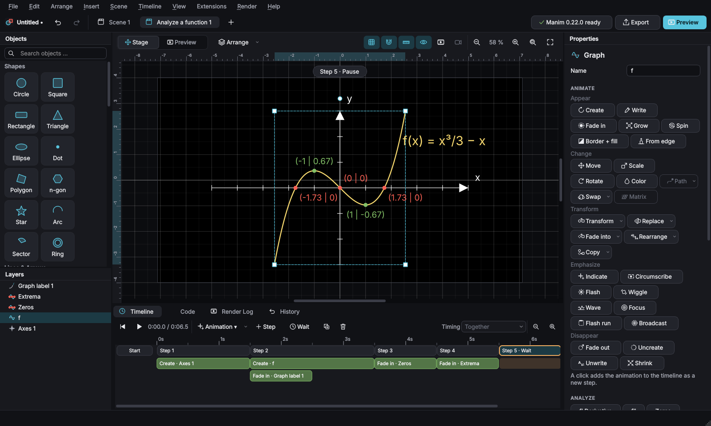

# Manim Studio

*Ganim – a GUI for [Manim](https://www.manim.community)*

[](https://github.com/Billi-Bons-minions/Ganim/actions/workflows/ci.yml)
[](LICENSE)


**Manim Studio lets you build math animations with the mouse.** You place objects on a stage, add animations on a timeline and press *Preview*. In the background the app writes a clean [Manim Community](https://www.manim.community) script and renders it with Manim. You never have to write Python, but you can always look at the script, export it and keep working on it by hand.

The interface is available in **English and German** (*Edit → Settings*). A German guide is in [docs/ANLEITUNG.md](docs/ANLEITUNG.md).



## Made with Manim Studio

All of these clips were made from the built-in templates and the projects in [examples](examples), and exported as GIF by the app itself, without touching any code.

| | | |
|---|---|---|
|  |  |  |
| Zeros and extrema of a function | A parameter h runs to 0: the secant becomes the tangent | Highlighting a path in a network |
|  |  |  |
| A shear applied to the coordinate grid | 3D solids with a camera move | Stream lines of a vector field |
|  |  |  |
| A label follows a dot; a dot driven by a parameter | Polar grid, a rose turns into a cardioid | Vector addition in space with a camera orbit |

## Features

**Objects**
- Shapes: circle, square, rectangle, triangle, ellipse, polygon, regular polygon, star, arc, sector, ring, **boolean shapes** (union, intersection, difference and exclusion of two shapes, e.g. for Venn diagrams; they follow their shapes when these move), line, dashed line, arrow, double arrow, curved arrow (`CurvedArrow`, `CurvedDoubleArrow`, `ArcBetweenPoints`), vector, dot, brace, highlight (frame, background, underline, strike-through), angle marks, motion traces
- Text: text with colored words, Markup text, bullet lists, code blocks with syntax highlighting, tables; with LaTeX also formulas (`MathTex`, `Tex`) with colored parts, matrices and an optional computed result (`= 3.50`, live with parameters)
- Math: number line, number plane (square or polar grid), coordinate system with labels, function graphs (`2x^2 + sin(x)`, piecewise, parametric, polar, implicit `f(x, y) = 0`, derivatives, integral functions F(x) = ∫ f(t) dt), area under a curve, Riemann rectangles, tangents and secants with a live label of their current term (e.g. `t(x) = 1.50x − 0.25`, also while they move along the graph), secants with slope triangle (let h run to 0 and the secant becomes the tangent), points on graphs, zeros/extrema/inflection points/intersections, graph labels, tables of values, data points with regression lines, bar charts (CSV import), vector fields (arrows or stream lines), networks of vertices and edges (Manim's `Graph`/`DiGraph` with several layouts)
- 3D: 3D axes, surfaces `z = f(x, y)` or parametric `x(u, v), y(u, v), z(u, v)`, 3D curves, solids (sphere, cube, box, cone, cylinder, torus and the Platonic solids tetrahedron, octahedron, icosahedron, dodecahedron), arrows, lines and points in space, camera orbits and camera moves
- Images (PNG, JPG, SVG), groups, layers, lock/hide, align and distribute

**Animations** (each with duration, delay and easing)
- Appear: Create, Write, Fade in (with direction and zoom), Grow, Spin in, Border then fill, Add letters, Type with cursor, Grow arrow, Grow from edge, One by one
- Change: Move, Scale, Rotate (also around a fixed point), Change color, Move along a path, Swap, **Linear map** (`ApplyMatrix`), Change value of a parameter, 3D camera orbit
- Transform: Transform, Replacement transform, Fade transform, Transform matching shapes, Transform from copy
- Emphasize: Indicate, Circumscribe, Flash, Wiggle, Apply wave, Focus on, Passing flash, Broadcast, **Highlight vertices/edges** of a network
- Disappear: Fade out, Uncreate, Unwrite, Shrink to center
- Steps play their animations together, staggered or one after another. A 2D camera can move and zoom, and **objects can be coupled** (Manim updaters): a label can follow a moving dot, the camera can follow an object, and a position can come from a formula like `x = 2 cos(w)`, `y = 2 sin(w)` driven by a parameter.

**Parameters (ValueTracker)**: sliders such as `a` can be used in every formula (graphs, areas, tangents, surfaces, vector fields, positions) and animated with *Change value*. A number on screen can show a parameter or a formula of parameters (e.g. `a^2/2`). Formulas of numbers, positions and computed results can also use **values of function graphs**: name a graph `f` and write `f(a)`, `f(2) + 1` or `g(a)` for its derivative `g`. The stage updates live.

**Stage and timeline**
- The stage uses Manim's coordinates and shows every moment of the animation: press *Space* to play it on the stage without rendering
- Edits at a timeline step are recorded as animations (like keyframes in presentation software)
- Undo/redo for everything, copy and paste between scenes, several scenes per project
- Video formats 16:9, 9:16 (shorts), 1:1 and 4:3

**Preview and export**
- Quick preview (480p or 720p) inside the app, also starting from any step
- Export as **MP4, WebM, MOV, GIF or PNG** (last frame or state after a step) in 480p, 720p, 1080p, 1440p, 4K or a custom size; transparent background (MOV/WebM/PNG)
- All scenes as separate videos or joined into one (hard cut or fade), sections as separate clips, subtitles (`.srt`) and sound per step
- Export of the generated Python script; the code view shows it at any time

**More**
- 16 templates (e.g. title card, function analysis, secant to tangent, sliding tangent, Pythagorean theorem, orbit, 3D solids, conic sections, presentation slide, graph theory, linear map, sets with a Venn diagram) and 5 example projects in the welcome dialog
- Interactive tour, hover previews for every animation, a list of all keyboard shortcuts (*F1*)
- Dark and light theme, adjustable UI scale, German and English
- Autosave and recovery after a crash, project packages (project and images in one file), your own styles, building blocks and templates
- Import of simple Manim scripts, custom code steps for advanced users, plugins (see [examples/plugins](examples/plugins))
- Clear error messages: missing Manim/LaTeX/FFmpeg is detected at start, render errors are explained (for LaTeX, with the formula that failed), and the full render log is one click away

### What Manim Studio does not do (yet)
- It has no installer or app bundle yet: you install it with Python (see below).
- The script import (*File → Import Manim script*) is meant for simple scenes: it reads basic shapes, boolean shapes, lines and (curved) arrows, text and formulas, axes and number planes, plain function graphs, numbers, `ValueTracker`s, groups and the common animations. Everything else, including much of what Manim Studio itself writes (graph tools, 3D, networks, vector fields, lists), is skipped and listed. To keep working on a project, save it as `.msproj`.
- 3D scenes are limited to the objects listed above; moving and rotating 3D solids is not possible as an animation.

## Installation

You need **Python 3.10 to 3.13**. Manim needs a few system libraries; **LaTeX is optional** (without it everything works except formulas).

FFmpeg: Manim brings its own FFmpeg libraries (via *PyAV*), so a separate FFmpeg is usually not needed.

### Windows
1. Install Python from [python.org](https://www.python.org/downloads/) and tick *"Add Python to PATH"*.
2. Optional, for formulas: install [MiKTeX](https://miktex.org/download) and allow it to install packages automatically.
3. In a command prompt:
   ```bat
   python -m venv manim-studio-env
   manim-studio-env\Scripts\activate
   pip install git+https://github.com/Billi-Bons-minions/Ganim
   manim-studio
   ```

### macOS
1. Install [Homebrew](https://brew.sh), then:
   ```bash
   brew install python py3cairo pango pkg-config
   ```
2. Optional, for formulas: `brew install --cask mactex-no-gui`
3. Then:
   ```bash
   python3 -m venv manim-studio-env
   source manim-studio-env/bin/activate
   pip install git+https://github.com/Billi-Bons-minions/Ganim
   manim-studio
   ```

### Linux (Debian/Ubuntu)
1. System packages:
   ```bash
   sudo apt install python3-venv python3-dev build-essential libcairo2-dev libpango1.0-dev pkg-config ffmpeg
   ```
2. Optional, for formulas:
   ```bash
   sudo apt install texlive texlive-latex-extra dvisvgm
   ```
3. Then:
   ```bash
   python3 -m venv manim-studio-env
   source manim-studio-env/bin/activate
   pip install git+https://github.com/Billi-Bons-minions/Ganim
   manim-studio
   ```
Other distributions have similar packages (Fedora: `cairo-devel pango-devel`). See also the [Manim installation guide](https://docs.manim.community/en/stable/installation.html).

### From a clone (for development)
```bash
git clone https://github.com/Billi-Bons-minions/Ganim.git
cd Ganim
python -m venv .venv
source .venv/bin/activate          # Windows: .venv\Scripts\activate
pip install -e ".[dev]"
python -m manim_studio             # or: manim-studio
```
You can open a project directly: `manim-studio my-project.msproj`.

At the first start Manim Studio checks in the background whether Manim, FFmpeg and LaTeX are available and tells you what is missing (again under *Render → System Check …*). If Manim lives in a different Python environment, choose its interpreter under *Edit → Settings → Python for Manim*.

## Quickstart: your first animation in two minutes

**Goal:** a circle appears, turns into a square, then a text is written.

1. In the **Objects** panel on the left, click *Circle*, *Square* and *Text* (or drag them onto the stage). Put the square on top of the circle.
2. Click the **circle**, then in the timeline **Animation ▾ → Create**. *Step 1* appears.
3. Click the **circle**, hold **Ctrl** and click the **square**, then **Animation ▾ → Transform**. The first selected object turns into the second (*Step 2*).
4. Click the **text**, then **Animation ▾ → Write** (*Step 3*). Change the text in the properties panel on the right.
5. Press **Space** to play it on the stage, or **F5** for a real Manim preview.
6. **File → Export …**: choose *Video (MP4)*, the quality and a folder, then *Export*.

Good to know:
- **Steps:** all animations of a step play at the same time (or staggered / one after another, see *Timing*). *Animation ▾* creates a new step; the buttons in the properties panel add to the timeline as well.
- **Visibility:** an object stays invisible until an animation brings it in (Create, Write, Fade in …). Invisible objects are shown as faint "ghosts" on the stage.
- **Stage and timeline:** with *Start* selected, dragging changes where an object starts. With a step selected, dragging records a *Move*, *Scale* or *Rotate* animation in that step.
- **Formulas for graphs** accept `x`, numbers, `+ - * / ^`, brackets, implicit multiplication (`2x`, `3sin(x)`), `pi`, `e`, and `sin cos tan asin acos atan sinh cosh tanh exp log ln log10 log2 sqrt abs floor ceil sign`.
- **Shortcuts:** *F1* shows all of them. The most important ones: *Ctrl+Z/Y* undo/redo, *Ctrl+D* duplicate, *Del* delete, *Ctrl+T* new step, *Ctrl+W* wait step, *Space* play on stage, *F5* preview, *Ctrl+E* export.

## Examples and templates

- **Templates** (*Scene → New scene from template*): title and subtitle, analyze a function, explore a parameter, compare two columns, analyze data, Pythagorean theorem, orbit with trace, flow (vector field), 3D solids with camera move, conic sections, presentation slide, graph theory (a path), linear map (shear), from secant to tangent, a tangent sliding along the graph.
- **Example projects** (welcome dialog): circle becomes square, function graph, motion, formula, title card.
- The folder [examples](examples) contains example projects to open with *File → Open* and an example plugin.

## The generated script

The code view shows the complete script at any time; *File → Export Script (.py) …* saves it as a `.py` file that renders without Manim Studio:

```bash
manim -pql my_scene.py Scene1
```

Every scene becomes a class, every object a variable, every step one `self.play(...)` or `self.wait(...)`. Texts, formulas and file names are embedded as checked string literals; function terms are parsed and checked against a fixed list of allowed building blocks. User input is never passed to `eval`.

## Troubleshooting

| Problem | Solution |
|---|---|
| "Manim is not installed in the configured Python interpreter" | Run `pip install manim` in that environment, or pick the right interpreter under *Edit → Settings → Python for Manim*. |
| Formulas only show their source in grey | LaTeX is missing (`latex` and `dvisvgm` must be on the PATH) or the formula has an error; the note in the properties panel tells you which. |
| Rendering fails | The message names the cause; the full log is in the *Render Log* tab. |
| On Linux the app does not start (Qt platform error) | Install the missing Qt libraries, e.g. `sudo apt install libxcb-cursor0`. |
| `pip install` fails while building `manimpango` or `pycairo` | The Cairo/Pango development packages are missing (see the installation steps for your system). |

## Development

```bash
pip install -e ".[dev]"
QT_QPA_PLATFORM=offscreen pytest -q          # all tests, including real Manim renders (a few minutes)
QT_QPA_PLATFORM=offscreen pytest -q -m "not manim"   # without Manim renders (about a minute)
ruff check manim_studio tests tools examples packaging
```

`tools/fuzz_sessions.py` plays random editing sessions through the real app and checks every result with Manim. `packaging/build_bundle.py` builds an experimental self-contained folder with PyInstaller (Python, Qt and Manim included, LaTeX not); so far it is only tested on Linux. How the code is organized and how to add an object or animation is described in [CONTRIBUTING.md](CONTRIBUTING.md). Changes are listed in [CHANGELOG.md](CHANGELOG.md).

## License

Manim Studio is released under the [MIT License](LICENSE).

It uses [Manim Community](https://www.manim.community) (MIT), [PySide6 / Qt for Python](https://doc.qt.io/qtforpython/) (LGPL-3.0), NumPy (BSD) and NetworkX (BSD). Manim renders with FFmpeg via PyAV and, for formulas, with your LaTeX installation. If you distribute Manim Studio together with these libraries (e.g. as a bundled app), their licenses apply to them; for PySide6 this means the LGPL-3.0 conditions.

## Deutsch

Manim Studio ist eine Desktop-App, mit der du Manim-Animationen per Maus baust – ohne Code. Die Oberfläche gibt es komplett auf Deutsch (auf deutschen Systemen automatisch, sonst unter *Bearbeiten → Einstellungen → Sprache*). Installation und Bedienung auf Deutsch: **[docs/ANLEITUNG.md](docs/ANLEITUNG.md)**.
