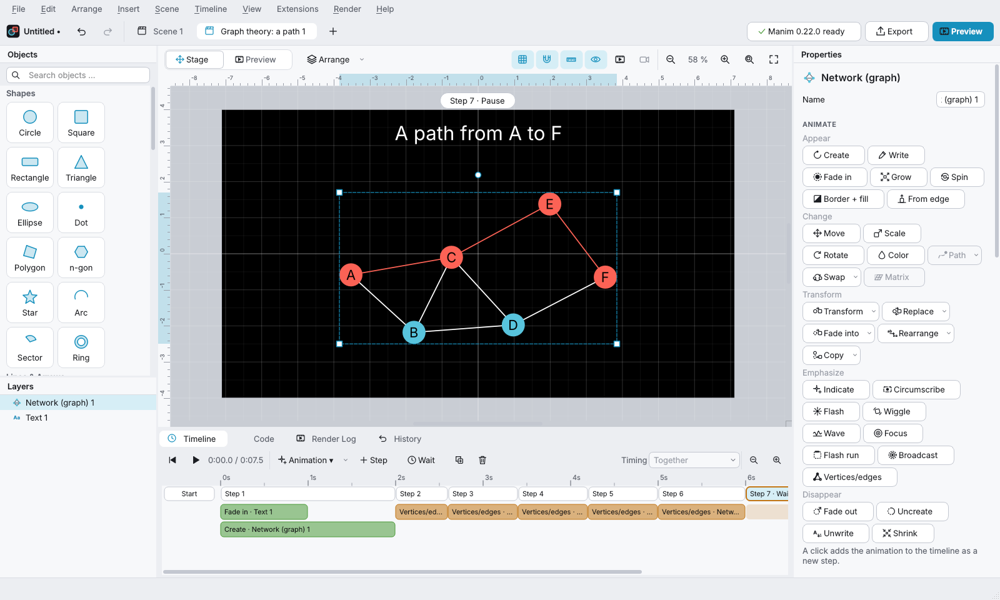

# Manim Studio – Anleitung (Deutsch)

Mit Manim Studio baust du Animationen für die [Manim Community Edition](https://www.manim.community) per Maus, ohne Code zu schreiben. Im Hintergrund erzeugt die App ein gültiges Manim-Skript und rendert es mit Manim. Das Skript kannst du jederzeit ansehen und exportieren.

Die Oberfläche ist auf Deutsch und Englisch verfügbar. Auf deutschen Systemen startet sie auf Deutsch; umstellen kannst du das unter *Bearbeiten → Einstellungen … → Sprache*.



## Installation

Du brauchst **Python 3.10 bis 3.13**. Manim braucht außerdem einige Systembibliotheken. **LaTeX ist optional**: Ohne LaTeX funktioniert alles außer Formeln (und Zahlen mit Einheit).

> FFmpeg: Manim bringt über das Paket *PyAV* eigene FFmpeg-Bibliotheken mit. Ein separat installiertes FFmpeg ist meist nicht nötig.

### Windows
1. Python von [python.org](https://www.python.org/downloads/) installieren und dabei *„Add Python to PATH“* ankreuzen.
2. Optional für Formeln: [MiKTeX](https://miktex.org/download) installieren und die automatische Paketinstallation erlauben.
3. In der Eingabeaufforderung:
   ```bat
   python -m venv manim-studio-env
   manim-studio-env\Scripts\activate
   pip install git+https://github.com/Billi-Bons-minions/Ganim
   manim-studio
   ```

### macOS
1. [Homebrew](https://brew.sh) installieren, dann `brew install python py3cairo pango pkg-config`
2. Optional für Formeln: `brew install --cask mactex-no-gui`
3. Dann:
   ```bash
   python3 -m venv manim-studio-env
   source manim-studio-env/bin/activate
   pip install git+https://github.com/Billi-Bons-minions/Ganim
   manim-studio
   ```

### Linux (Debian/Ubuntu)
1. `sudo apt install python3-venv python3-dev build-essential libcairo2-dev libpango1.0-dev pkg-config ffmpeg`
2. Optional für Formeln: `sudo apt install texlive texlive-latex-extra dvisvgm`
3. Dann:
   ```bash
   python3 -m venv manim-studio-env
   source manim-studio-env/bin/activate
   pip install git+https://github.com/Billi-Bons-minions/Ganim
   manim-studio
   ```

Beim nächsten Mal genügt es, die Umgebung zu aktivieren und `manim-studio` zu starten. Ein Projekt öffnest du direkt mit `manim-studio meinprojekt.msproj`.

Beim Start prüft Manim Studio im Hintergrund, ob Manim, FFmpeg und LaTeX vorhanden sind, und sagt dir, was fehlt (erneut unter *Rendern → Systemprüfung …*). Liegt Manim in einer anderen Python-Umgebung, stellst du den Interpreter unter *Bearbeiten → Einstellungen … → Python für Manim* ein.

## Die erste Animation in 2 Minuten

**Ziel:** Ein Kreis erscheint, verwandelt sich in ein Quadrat, dann wird ein Text geschrieben.

1. Links unter **Objekte** auf *Kreis*, *Quadrat* und *Text* klicken (oder auf die Bühne ziehen). Das Quadrat auf den Kreis legen.
2. Den **Kreis** anklicken, dann in der Zeitleiste **Animation ▾ → Erstellen (Create)**. Es entsteht *Schritt 1*.
3. Den **Kreis** anklicken, mit **Strg** zusätzlich das **Quadrat** anklicken, dann **Animation ▾ → Verwandeln (Transform)**. Das zuerst gewählte Objekt verwandelt sich in das zweite (*Schritt 2*).
4. Den **Text** anklicken, dann **Animation ▾ → Schreiben (Write)** (*Schritt 3*). Den Text änderst du rechts im Eigenschaften-Panel.
5. **Leertaste** spielt alles auf der Bühne ab, **F5** rendert eine echte Manim-Vorschau.
6. **Datei → Exportieren …**: Format *Video (MP4)*, Qualität und Ordner wählen, dann *Exportieren*.

Im Raum gibt es 3D-Achsen, Flächen, Kurven, Körper (auch die platonischen Körper Tetraeder, Oktaeder, Ikosaeder und Dodekaeder) sowie Pfeile, Strecken und Punkte (Bereich *3D* der Objektbibliothek oder Menü *Einfügen*).

Es geht auch ohne leere Bühne: Im Willkommensdialog gibt es fünf Beispielprojekte, und unter *Szene → Neue Szene aus Vorlage* findest du 15 Vorlagen (z. B. Kurvendiskussion, von der Sekante zur Tangente, Tangente wandert am Graphen, Satz des Pythagoras, Graphentheorie, lineare Abbildung).

## Wichtige Begriffe

- **Schritte:** Alle Animationen eines Schritts laufen gleichzeitig. Unter *Ablauf* lassen sie sich auch versetzt oder nacheinander abspielen. *Animation ▾* legt einen neuen Schritt an.
- **Sichtbarkeit:** Ein Objekt ist unsichtbar, bis eine Einblend-Animation (Erstellen, Schreiben, Einblenden …) es zeigt. Unsichtbare Objekte zeigt die Bühne als blasse „Geister“.
- **Bühne und Zeitleiste:** Ist **Start** gewählt, ändert Ziehen die Startposition. Ist ein **Schritt** gewählt, wird Ziehen, Skalieren und Drehen als Animation in diesem Schritt aufgenommen.
- **Parameter:** Ein Parameter (z. B. `a`) ist ein Regler. Du kannst ihn in allen Formeln verwenden (Graphen, Flächen, Tangenten, Flächen im Raum, Vektorfelder, Positionen) und mit *Wert ändern* animieren. Eine *Zahl* kann einen Parameter oder eine Formel aus Parametern anzeigen (Feld *Formel*, z. B. `a^2/2`); sie rechnet beim Animieren mit.
- **Werkzeuge am Graphen:** Wähle einen Funktionsgraphen; im Eigenschaften-Panel fügen Knöpfe unter anderem Ableitung, Nullstellen, Extrema, Tangente, Sekante, Punkt, Fläche, Riemann-Summe, Beschriftung oder Wertetabelle hinzu. Koppelst du die Schrittweite *h* einer Sekante an einen Parameter und lässt ihn gegen 0 laufen, wird die Sekante zur Tangente.
- **Tangente mit Term:** Koppel bei der Tangente *x folgt Parameter* an einen Parameter und animiere ihn mit *Wert ändern* – die Tangente wandert am Graphen. Unter *Beschriftung* wählst du *Term* (`t(x) = 1.50x − 0.25`), *Gleichung* oder *Steigung*; die Beschriftung läuft mit und zeigt immer den aktuellen Wert. Fertiges Beispiel: Vorlage *Tangente wandert am Graphen*.
- **Kopplung:** Im Eigenschaften-Panel unter *Kopplung* kann ein Objekt einem anderen folgen (z. B. eine Beschriftung neben einem wandernden Punkt; auch die Kamera kann folgen) oder seine Position aus einer Formel mit Parametern nehmen, etwa `x = 2 cos(w)`, `y = 2 sin(w)`.
- **Funktionsterme:** erlaubt sind `x`, Zahlen (auch `0,5`), `+ - * / ^`, Klammern, implizite Multiplikation (`2x`, `3sin(x)`), `pi`, `e` und die Funktionen `sin cos tan asin acos atan sinh cosh tanh exp log ln log10 log2 sqrt abs floor ceil sign`.

## Tastenkürzel

**F1** zeigt alle Tastenkürzel. Die wichtigsten:

| Aktion | Kürzel |
|---|---|
| Rückgängig / Wiederholen | Strg+Z / Strg+Y |
| Duplizieren / Löschen | Strg+D / Entf |
| Neuer Schritt / Warte-Schritt | Strg+T / Strg+W |
| Vorheriger / nächster Schritt | Bild↑ / Bild↓ |
| Auf der Bühne abspielen | Leertaste |
| Vorschau / ab gewähltem Schritt | F5 / Strg+F5 |
| Exportieren / Skript exportieren | Strg+E / Strg+Umschalt+E |
| Gruppieren / Gruppe auflösen | Strg+G / Strg+Umschalt+G |
| Einpassen / Auf Auswahl zoomen | Strg+0 / Strg+Umschalt+0 |

## Export

*Datei → Exportieren …* bietet MP4, WebM, MOV, GIF und PNG (Ende der Szene oder Zustand nach einem Schritt) in 480p bis 4K oder eigener Größe, auch mit transparentem Hintergrund (MOV, WebM, PNG). Mehrere Szenen lassen sich einzeln oder als ein Gesamtvideo exportieren; Abschnitte, Untertitel (`.srt`) und Ton pro Schritt sind möglich.

*Datei → Skript exportieren (.py) …* speichert das Manim-Skript. Es läuft auch ohne Manim Studio:

```bash
manim -pql meine_szene.py Szene1
```

## Fehlerbehebung

| Problem | Lösung |
|---|---|
| „Manim ist im eingestellten Python-Interpreter nicht installiert“ | `pip install manim` in der verwendeten Umgebung ausführen oder unter *Bearbeiten → Einstellungen … → Python für Manim* den richtigen Interpreter wählen. |
| Formeln erscheinen nur als grauer Quelltext | LaTeX fehlt (`latex` und `dvisvgm` müssen im PATH liegen) oder die Formel enthält einen Fehler; der Hinweis im Eigenschaften-Panel nennt den Grund. |
| Rendern schlägt fehl | Die Meldung nennt die Ursache; das vollständige Log steht im Tab *Render-Log*. |
| Unter Linux startet die App nicht (Qt-Plattform-Fehler) | Fehlende Qt-Bibliotheken installieren, z. B. `sudo apt install libxcb-cursor0`. |
| `pip install` scheitert bei `manimpango` oder `pycairo` | Die Entwicklerpakete von Cairo/Pango fehlen (siehe Installation). |

Fehler und Ideen gern als [Issue auf GitHub](https://github.com/Billi-Bons-minions/Ganim/issues). Hinweise für Mitwirkende stehen in [CONTRIBUTING.md](../CONTRIBUTING.md) (englisch).
